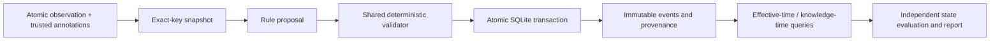

# Correction-aware memory

A delayed report should not overwrite a newer fact. An authorized correction should revise an assertion while preserving what was known before the correction arrived.

This repository implements a small, auditable memory system and a reproducible offline benchmark. **Current status: Release A, deterministic engineering baseline. No model weights downloaded, no adapter trained, no human label review, no learned-model advantage claimed.**

## See the behavior first

```bash
uv sync --locked
uv run python -m cam.cli demo --out runs/demo --offline
```

Inspect `runs/demo/trace.json` and its SQLite ledger. The actual demo runs these four observations through the shared validator and transaction path:

| Observed | Effective | Claim | Action |
|---|---|---|---|
| Oct 1 | Oct 1 | preliminary | create |
| Oct 8 | Oct 7 | published | supersede |
| Oct 9 | Oct 1 | preliminary, delayed | no_op: stale |
| Oct 10 | Oct 7 | withdrawn, authorized correction | update |

The same effective date, October 8, returns **published** using October 9 knowledge and **withdrawn** using October 10 knowledge. October 2 remains **preliminary**. The original published assertion remains in the immutable ledger. These are synthetic fixed demo dates.

## Reproduce the offline experiment

Requires Python 3.12 and [uv](https://docs.astral.sh/uv/). `uv sync --locked` installs only the locked development/test environment; core execution uses the Python standard library. Dependency installation needs package access unless cached. Once installed, the CLI performs no network access and needs no model, API key or GPU.

Run from the repository root, using fresh output directories:

```bash
uv sync --locked
uv run python -m pytest tests -q
uv run python -m cam.cli check --fixtures data/fixtures --offline
uv run python -m cam.cli generate --config configs/offline.json --out data/generated --offline
uv run python -m cam.cli evaluate --config configs/offline.json --out runs/rule --offline
uv run python -m cam.cli report --run runs/rule --out runs/rule/report --offline
```

Open `runs/rule/report/index.html` directly in a browser. Report generation reads saved artifacts and never calls a model. Existing nonempty output directories are rejected to preserve earlier runs; for a second experiment choose a fresh `--out`, and point `data.manifest` in a copied config to the new generated manifest. Re-evaluation can reuse the unchanged existing dataset with a fresh run directory.

The generator's seed-11 pilot has **50 trajectories, 412 observations and 1,005 state checkpoints**. The first measured rule run had action macro-F1 **1.000**, state exact match **1,005/1,005**, stale-active **0/561**, missing-state **0/1,005**, and false-overwrite **0/209**. These are automated development-pilot results on annotated synthetic inputs, without human label validation. [Results and interpretation](docs/results.md) · [Methods](docs/methods.md) · [Dataset card](docs/dataset-card.md).

## Architecture and decisions



- Five actions: `create`, `reinforce`, `supersede`, `update`, `no_op`. Explicit null assertions represent retractions.
- The model/proposer cannot supply new values, dates, authority, sources or arbitrary writes. The validator checks the loaded envelope, candidate history, evidence span and operation preconditions.
- Corrections append lineage rather than rewriting past rows. SQL triggers prevent update/delete of ledger tables; projections are rebuilt from immutable records.
- Observation identity and decision-attempt identity are distinct. Exact retries are idempotent; a rejected revision-conflict attempt can retry on a fresh snapshot without losing its audit trail.
- Gold-history operation classification and independent closed-loop state replay are separate. Fixed action labels are never applied to incompatible recovery contexts.
- The world generator/oracle does not call the production proposer, validator or temporal query implementation. Gold labels and future observations never enter proposer requests.

## What is and is not complete

| Plan area | Status |
|---|---|
| Contracts, original fixtures, validated ledger, rule policy | Implemented and tested |
| Original pilot, independent expected states, offline CLI/report | Implemented and experimentally exercised |
| Human label audit | [50-event review packet](audits/pilot-seed11/review.md) prepared; 0 actual human reviewers |
| Prompted Qwen3 runtime | Deferred; not implemented/evaluated |
| LoRA training and saved adapter | Deferred; no adapter exists |
| Matched learned-model comparisons and uncertainty | Deferred; no model effect estimated |

The training gate is currently **training_not_justified** for a research campaign: supplied annotations let transparent rules solve this pilot. A small future SFT run could demonstrate structured-rule imitation. A claim of a learned-memory contribution needs a separately justified task and independent label review. Model evaluation/training requests return exit **3**, never silently substitute rule results.

CLI exit codes: `0` success, `2` invalid input/config, `3` unavailable optional experiment, `4` failed correctness gate. All generated artifacts stay inside the selected output directory.

## Inspect the evidence

Each run contains raw requests/proposals for both tracks, commit/rejection results, checkpoint scores, per-trajectory metrics, current and gold-history SQLite ledgers, resolved configuration, dataset identity, code commit/dirty status, dependency-lock hash and environment. `label-audit.jsonl` and `label-audit.md` prepare 50 stratified pilot events; reviewer/verdict fields start null. Inspect the committed [canonical trace](examples/canonical-trace.json) or [complete portable smoke run](examples/smoke/README.md).

The [pilot review packet](audits/pilot-seed11/review.md) includes the exact source, supplied trust/correction metadata, prior assertion history, expected proposal, and temporal checkpoints for each of 50 events. Record actual human decisions in [review.csv](audits/pilot-seed11/review.csv); the [audit manifest](audits/pilot-seed11/manifest.json) binds the sample to its dataset and source commit. These verdict fields are intentionally empty until reviewed.

The task plan and execution record are under [docs/superpowers](docs/superpowers/plans/2026-10-17-correction-aware-memory.md) and [docs/progress.md](docs/progress.md). Code is MIT-licensed; original synthetic data is designated CC0-1.0. This project is not a full MEMORA/PSD reproduction or a validated novel memory method. [Related work and remaining novelty audit](docs/novelty-audit.md).

**Next concrete task:** work through the [50-event pilot audit](audits/pilot-seed11/review.md), record disagreements in its CSV, then decide whether an educational Qwen3-0.6B SFT experiment provides useful evidence beyond this deterministic milestone.
