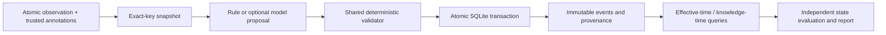

# Correction-aware memory

A delayed report should not overwrite a newer fact. An authorized correction should revise an assertion while preserving what was known before the correction arrived.

This repository implements a small, auditable memory system and a reproducible offline benchmark. **Current status: deterministic baseline plus real, saved/reloaded educational LoRA adapters. The bounded adjustment matched 13/20 training targets, below the 20/20 overfit goal. A matched five-trajectory development comparison is now recorded; human review and the full final study remain unfinished. No learned-memory advantage is claimed.**

## See the behavior first

```bash
uv sync --locked
uv run python -m cam.cli demo --out runs/demo --offline
```

Inspect `runs/demo/trace.json` and its SQLite ledger. The actual demo runs these four observations through the shared validator and transaction path:

| Observed | Effective | Claim | Action |
|---|---|---|---|
| Oct 1 | Oct 1 | preliminary | create |
| Oct 8 | Oct 7 | published | supersede |
| Oct 9 | Oct 1 | preliminary, delayed | no_op: stale |
| Oct 10 | Oct 7 | withdrawn, authorized correction | update |

The same effective date, October 8, returns **published** using October 9 knowledge and **withdrawn** using October 10 knowledge. October 2 remains **preliminary**. The original published assertion remains in the immutable ledger. These are synthetic fixed demo dates.

## Reproduce the offline experiment

Requires Python 3.12 and [uv](https://docs.astral.sh/uv/). `uv sync --locked` installs only the locked development/test environment; core execution uses the Python standard library. Dependency installation needs package access unless cached. Once installed, the offline commands below perform no network access and need no model, API key or GPU.

Run from the repository root, using fresh output directories:

```bash
uv sync --locked
uv run python -m pytest tests -q
uv run python -m cam.cli check --fixtures data/fixtures --offline
uv run python -m cam.cli generate --config configs/offline.json --out data/generated --offline
uv run python -m cam.cli evaluate --config configs/offline.json --out runs/rule --offline
uv run python -m cam.cli report --run runs/rule --out runs/rule/report --offline
```

Open `runs/rule/report/index.html` directly in a browser. Report generation reads saved artifacts and never calls a model. Existing nonempty output directories are rejected to preserve earlier runs; for a second experiment choose a fresh `--out`, and point `data.manifest` in a copied config to the new generated manifest. Re-evaluation can reuse the unchanged existing dataset with a fresh run directory.

The generator's seed-11 pilot has **50 trajectories, 412 observations and 1,005 state checkpoints**. The first measured rule run had action macro-F1 **1.000**, state exact match **1,005/1,005**, stale-active **0/561**, missing-state **0/1,005**, and false-overwrite **0/209**. These are automated development-pilot results on annotated synthetic inputs, without human label validation. [Results and interpretation](docs/results.md) · [Methods](docs/methods.md) · [Dataset card](docs/dataset-card.md).

## Architecture and decisions



- Five actions: `create`, `reinforce`, `supersede`, `update`, `no_op`. Explicit null assertions represent retractions.
- The model/proposer cannot supply new values, dates, authority, sources or arbitrary writes. The validator checks the loaded envelope, candidate history, evidence span and operation preconditions.
- Corrections append lineage rather than rewriting past rows. SQL triggers prevent update/delete of ledger tables; projections are rebuilt from immutable records.
- Observation identity and decision-attempt identity are distinct. Exact retries are idempotent; a rejected revision-conflict attempt can retry on a fresh snapshot without losing its audit trail.
- Gold-history operation classification and independent closed-loop state replay are separate. Fixed action labels are never applied to incompatible recovery contexts.
- The world generator/oracle does not call the production proposer, validator or temporal query implementation. Gold labels and future observations never enter proposer requests.

## What is and is not complete

| Plan area | Status |
|---|---|
| Contracts, original fixtures, validated ledger, rule policy | Implemented and tested |
| Original pilot, independent expected states, offline CLI/report | Implemented and experimentally exercised |
| Human label audit | [50-event review packet](audits/pilot-seed11/review.md) prepared; 0 actual human reviewers |
| Prompted Qwen3 runtime | Real CPU smoke complete; 0/10 schema-valid proposals; [raw evidence](examples/qwen-smoke-cpu/README.md) |
| LoRA training and saved adapter | Two bounded educational runs saved/reloaded; full 20/20 overfit goal unmet |
| Matched model comparisons and uncertainty | Five development trajectories, all five arms and paired intervals recorded; full final study deferred |

The research-training gate is **training_not_justified**: supplied annotations let transparent rules solve this unaudited pilot. The original brief permits a tiny `educational_imitation_only` control, which has now run with a saved adapter and exact reload proof. Training is capped at twenty examples and three epochs; research training remains disabled. A learned-memory claim still needs a separately justified task and independent label review. Missing optional runtimes return exit **3**; rule results are never substituted.

## Optional model diagnostics

[Model setup and exact commands](docs/model-runtime.md) use a pinned Qwen3-0.6B model/tokenizer, lazy ML imports, strict JSON output, and the same deterministic commit guard. Install optional dependencies with `uv sync --locked --extra ml`. This installs libraries only; model commands always load cached files and never download weights.

After explicitly caching the approved revision and generating the pilot above:

```bash
uv run --locked --extra ml python -m cam.cli model-smoke --config configs/base.json --out runs/qwen-smoke --offline
```

The smoke records ten pilot/development requests, raw responses and failures, token counts, prompt hashes, backend/dtype, latency/memory, and a tiny backward compatibility probe. It never updates or saves weights. The first real CPU float32 run completed in **28.9 seconds excluding model load**, peaked at **4.89 GiB** including its passing four-token backward probe, and produced **0/10 schema-valid proposals**: every response omitted `review_required`. All ten selected requests were initial-create events, so this is a narrow runtime check, not a balanced benchmark. [Raw responses and interpretation](examples/qwen-smoke-cpu/README.md). Fake-runtime tests and randomly initialized tiny-model API checks remain distinct from this pretrained run.

## Educational adapter proof

Following the [original brief alignment check](docs/drift-audit.md), Task 6 now includes actual completion-only LoRA training with frozen-base hashes, preserved loss/output records and exact fresh-base reload tokens. The original default produced 2/20 exact training targets; the one allowed accumulation adjustment produced 13/20, with 20/20 schema-valid outputs and 13/20 guard-valid expected actions. Neither achieved full overfit. These figures describe training-target reproduction; the separate matched development results appear below.

[Default checkpoint and raw evidence](examples/educational-sft/README.md) · [Single adjustment and raw evidence](examples/educational-sft-overfit/README.md) · [Model card and reproduction](docs/model-card.md). Human reviewers remain zero, and the full final study is pending. A later matched development comparison is linked below.

## Matched development evidence

| Arm | Raw action F1 | Guard-valid F1 | State exact | Stale | Missing |
|---|---:|---:|---:|---:|---:|
| base | 0.050 | 0.000 | 0/103 | 0/38 | 103/103 |
| latest-arrival | 0.662 | 0.723 | 91/103 | 12/38 | 0/103 |
| rule | 1.000 | 1.000 | 103/103 | 0/38 | 0/103 |
| sft-adjusted | 0.474 | 0.513 | 75/103 | 15/38 | 0/103 |
| sft-default | 0.261 | 0.277 | 14/103 | 0/38 | 87/103 |

All five arms use the same 44 observations in two tracks; source `adede56`. Five trajectories and one training seed support exploratory diagnostics only. The latest-arrival arm is intentionally weak and retains all guards. [Full raw evidence, paired intervals and replay](examples/development-comparison/README.md) · [Registered settings](docs/development-comparison.md). Final test unopened; no additional training followed the comparison.

CLI exit codes: `0` success, `2` invalid input/config, `3` unavailable optional experiment, `4` failed correctness gate. All generated artifacts stay inside the selected output directory.

## Inspect the evidence

Each run contains raw requests/proposals for both tracks, commit/rejection results, checkpoint scores, per-trajectory metrics, current and gold-history SQLite ledgers, resolved configuration, dataset identity, code commit/dirty status, dependency-lock hash and environment. `label-audit.jsonl` and `label-audit.md` prepare 50 stratified pilot events; reviewer/verdict fields start null. Inspect the committed [canonical trace](examples/canonical-trace.json) or [complete portable smoke run](examples/smoke/README.md).

The [pilot review packet](audits/pilot-seed11/review.md) includes the exact source, supplied trust/correction metadata, prior assertion history, expected proposal, and temporal checkpoints for each of 50 events. Record actual human decisions in [review.csv](audits/pilot-seed11/review.csv); the [audit manifest](audits/pilot-seed11/manifest.json) binds the sample to its dataset and source commit. These verdict fields are intentionally empty until reviewed.

The task plan and execution record are under [docs/superpowers](docs/superpowers/plans/2026-10-17-correction-aware-memory.md) and [docs/progress.md](docs/progress.md). Code is MIT-licensed; original synthetic data is designated CC0-1.0. This project is not a full MEMORA/PSD reproduction or a validated novel memory method. [Related work and remaining novelty audit](docs/novelty-audit.md).

**Next concrete task:** implement the original Task 7 matched development comparison and uncertainty path; complete the [50-event human pilot audit](audits/pilot-seed11/review.md) before scientific claims. Keep final tests locked and report negative results rather than extending the training sweep.
